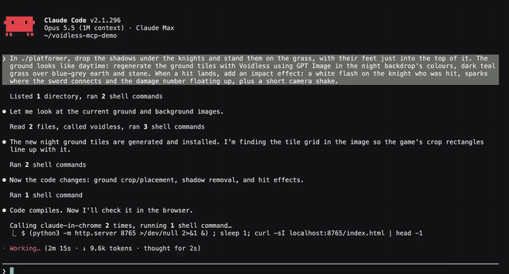

# Voidless for coding agents

Game art from Claude Code, Cursor, Codex or any MCP client: sprites, 8-direction turns, animation
sets, tilesets, UI, sound effects, music and 3D models. Every clip in a set keeps the same size and
palette, with the feet on the same line, so it drops into a game without cleanup.



*Claude Code made both knights, their idle/run/jump/attack/hurt/death clips, the swords, the
backdrop and the sound through this server, then wrote the game. About $3.50 CAD of assets.*

This repo has two parts:

- **[`server/`](server)**: the MCP server, published to npm as
  [`voidless-mcp`](https://www.npmjs.com/package/voidless-mcp) and listed in the official MCP
  registry as `dev.voidless/voidless`. A hosted copy runs at `https://mcp.voidless.dev/mcp`.
- **A Claude Code plugin**: the hosted server plus skills that teach the agent how to build a full
  character set, make tilesets, and import the result into Godot.

You need a [Voidless](https://voidless.dev) account. Generations spend credits from it, and each
tool's description lists its cost.

## Claude Code plugin

```
/plugin marketplace add voidless-03/voidless-mcp
/plugin install voidless@voidless
```

The first tool call opens a browser to sign in to Voidless. No API key needed.

Then ask for what you need:

- "Make a 64px pixel-art knight for a top-down game, turn it to 8 directions and give it a walk."
- "Import asset 115918 into this Godot project and set up the player."
- "Make a grass-and-dirt-path wang tileset in the same palette."
- "A coin pickup sound and a 60-second chiptune loop for the title screen."

| Skill | What it does |
|---|---|
| `game-art` | Which settings to use for sprites, props, backdrops and UI; credit rules |
| `character-set` | One sprite → 8-way turn → animation sets (top-down or platformer) |
| `tileset` | Platformer, wang and blob tilesets, and setting them up in Godot |
| `godot-import` | Downloads every clip and writes a SpriteFrames `.tres` for AnimatedSprite2D ([script](skills/godot-import/scripts/voidless-godot.mjs)) |

## Other clients

**Hosted (no install):** add `https://mcp.voidless.dev/mcp` as a remote MCP server and sign in.

- Claude (claude.ai, desktop, mobile): Settings → Connectors → Add custom connector.
- Claude Code without the plugin: `claude mcp add --transport http voidless https://mcp.voidless.dev/mcp`
- ChatGPT: Settings → Apps & Connectors → Advanced → Developer mode → Create → OAuth.
- Cursor, VS Code, Windsurf: add it as a remote server in their MCP settings.

**Local (npm):** for clients that run a local server, with an API key from
[voidless.dev/account](https://voidless.dev/account):

```json
{
  "mcpServers": {
    "voidless": {
      "command": "npx",
      "args": ["-y", "voidless-mcp"],
      "env": { "VOIDLESS_API_KEY": "void_..." }
    }
  }
}
```

The full tool list is in [`server/README.md`](server/README.md).

## Godot import without the plugin

```sh
VOIDLESS_API_KEY=void_... node skills/godot-import/scripts/voidless-godot.mjs --asset <id> --project path/to/game
```

Writes `res://art/<name>/<clip>/NN.png` and `res://art/<name>/<name>.tres`, with one animation per
clip (`walk_down`, `walk_down_right`, `attack_1`…) and an `idle_<facing>` frame for each turn image.
Tested with Godot 4.7.

## Links

[voidless.dev](https://voidless.dev) · [MCP setup guide](https://voidless.dev/mcp) ·
[API docs](https://voidless.dev/api-docs) · [Privacy](https://voidless.dev/privacy-policy) ·
contact@voidless.dev

MIT licensed.
